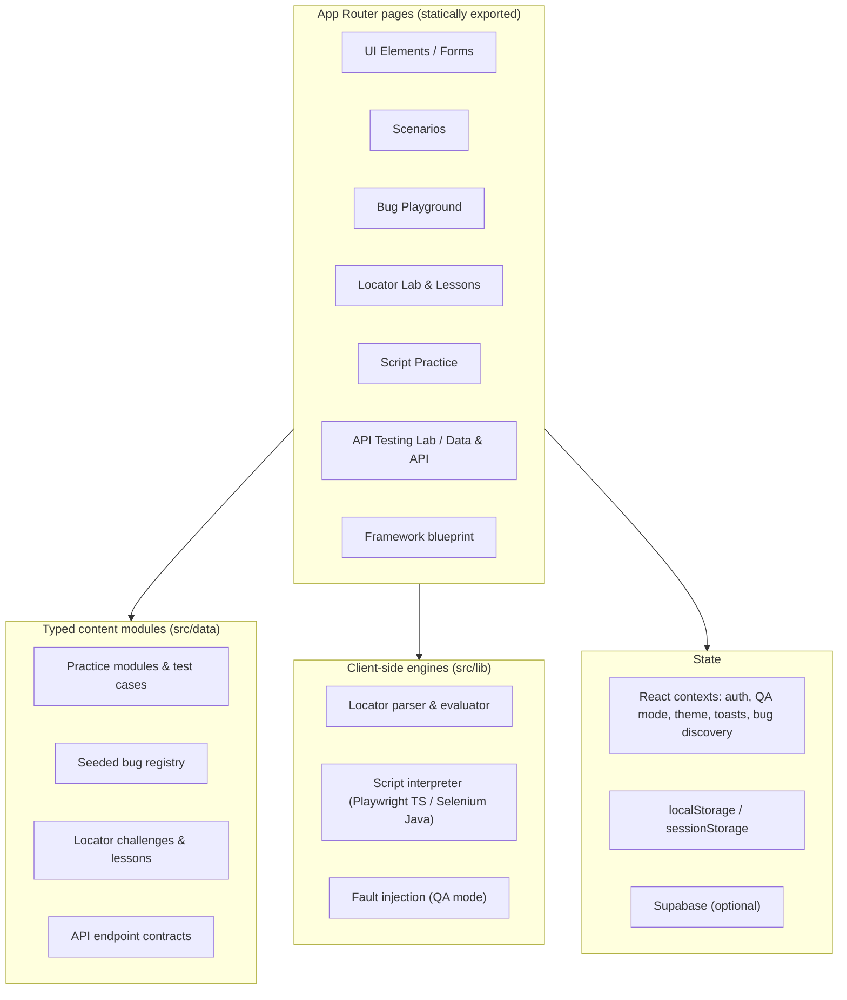

# QA Practice — Interactive QA Testing Platform

**Live application:** [qapractice.hakdogan.com](https://qapractice.hakdogan.com/)
**Author:** Hasan Akdogan · [hakdogan.com](https://www.hakdogan.com) · [LinkedIn](https://www.linkedin.com/in/hasanakdogan1/)

`Next.js 15` `React 19` `TypeScript` `Tailwind CSS v4` `Static export` `Supabase (optional)`

QA Practice is a public web application for learning and practising software testing. It gives manual and automation testers stable, predictable pages to test: UI controls, complete user flows, seeded bugs, API contracts and hard browser topics such as iframes and Shadow DOM. Learners can also turn failure conditions on and off. This case study explains what the platform does, how it is built, and the engineering decisions that make it a reliable practice target.

> This repository is the public case study for QA Practice. The application source is in a private repository. Everything described here is based on that source code. Simulated behaviour is labelled as a simulation, and evidence is limited to what was actually run.

---

## Table of Contents

- [At a Glance](#at-a-glance)
- [1. Project Overview](#1-project-overview)
- [2. Problem & Solution](#2-problem--solution)
- [3. Technical Architecture](#3-technical-architecture)
- [Architecture Diagrams](docs/architecture.md)
- [4. Testing Capabilities](#4-testing-capabilities)
- [5. Automation Opportunities (Playwright + TypeScript)](#5-automation-opportunities-playwright--typescript)
- [6. QA Engineering Decisions](#6-qa-engineering-decisions)
- [7. Test Strategy](#7-test-strategy)
- [8. Challenges & Solutions](#8-challenges--solutions)
- [9. Evidence & Live Demo](#9-evidence--live-demo)
- [10. My Role & Contributions](#10-my-role--contributions)

---

## At a Glance

| Area | What exists today |
|---|---|
| UI practice | 27 UI element modules and 10 form scenarios, each with written test cases (positive, negative, edge) |
| User-flow scenarios | 24 multi-step scenarios: authentication, cart and checkout, wallet, admin tables, network behaviour |
| Bug hunting | A demo storefront with **15 deliberately seeded defects**, a detection strategy for each one, and a Jira-style bug report |
| Locator training | 20 locator lessons with quizzes, and **50 locator challenges** across 4 difficulty levels |
| Frames & Shadow DOM | 12 scenarios for iframes (nested, cross-origin, delayed, detached) and open/closed Shadow DOM |
| API testing | 5 REST endpoints with contract checks and fault injection (500, missing field, wrong type, delay) |
| Fault simulation | A global "QA test mode" with 8 switchable failure conditions |
| Automation guidance | Playwright + TypeScript and Selenium + Java framework blueprints, plus a browser-based script runner |
| Automated checks in the repo | 21 Node-based test scripts (unit, content and build-output checks), all passing on the latest commit |

---

## 1. Project Overview

QA Practice is an interactive training platform for manual and automation testers. It provides **controlled, predictable web pages built to be tested**. A learner can practise one browser behaviour at a time, see the expected result, write a locator or a script for it, and then move on to full user flows and seeded bugs.

I built it for two reasons:

1. **Public demo sites are often poor practice targets.** They change without warning, they have no stable test hooks, and they rarely explain why a test failed.
2. **I wanted to show QA engineering as engineering.** The platform itself is designed for testability. It has stable `data-testid` attributes, deterministic data, explicit failure switches, and its own automated checks.

The application is public and free to use. No installation is needed.

---

## 2. Problem & Solution

| Problem for a learner | How QA Practice addresses it |
|---|---|
| Real sites change, so practice tests break for reasons that have nothing to do with the learner | Every practice surface is a fixed, versioned page with deterministic content |
| Tutorials show the happy path only | Each module lists positive, negative and edge-case scenarios with an expected result |
| Hard browser topics (iframes, Shadow DOM, portals, dynamic IDs, virtualized lists) are rarely available in one place | Dedicated scenarios isolate each topic and explain the boundary rule behind it |
| Learners write locators but get no feedback on *quality* | The Locator Lab evaluates the locator against real DOM and rates its resilience |
| Bug-hunting practice needs bugs that are known in advance | The Bug Playground contains 15 seeded defects with documented expected and actual results |
| Failure states (500s, slow APIs, expired sessions) are hard to reproduce on demand | A global QA test mode turns each failure condition on and off |
| Moving from "one test" to "a real framework" is a large step | Framework blueprints show the project structure, layers and conventions for two common stacks |

---

## 3. Technical Architecture

> Diagrams of the application, testing and deployment architecture: **[docs/architecture.md](docs/architecture.md)**

### Stack

- **Framework:** Next.js 15 (App Router) with React 19 and strict TypeScript
- **Styling:** Tailwind CSS v4 with theme tokens (light and dark themes)
- **Motion:** Framer Motion
- **Optional backend services:** Supabase Auth and a small progress table (see *State handling*)
- **Client-side utilities:** JSZip and FileSaver, used to build a downloadable Playwright project in the browser
- **Testing toolchain:** `tsx` + Node's built-in `assert` + `happy-dom` for DOM-level checks

### Deployment model

The application is built with `output: "export"`. This means production is a **fully static site**: HTML, JavaScript and CSS files served by a standard web host, with no Node.js server at runtime. A post-build script cleans the export (it removes OS artefacts and duplicate files) and packages it as one deployable archive.

I chose static export for these reasons:

- **Stability:** a practice target has no server state that can drift between runs.
- **Low operational risk:** no application server to patch or scale.
- **Repeatability:** the same build always produces the same pages.

### Frontend architecture

The main design rule is **content as typed data**. Modules, test cases, seeded bugs, locator challenges and API contracts are TypeScript objects, not hard-coded markup. Pages render them, and the test scripts validate them. This keeps hundreds of practice items consistent, and the compiler catches content errors before they reach the site.

### State handling

| State | Where it lives | Why |
|---|---|---|
| QA test mode flags | `sessionStorage` | Failures reset when the tab closes, so a learner never gets "stuck" in a broken state |
| Theme, sidebar, lesson progress, checklist progress | `localStorage` | Personal convenience settings that survive reloads |
| Bug Playground progress | `localStorage`, stored separately for each user; synced to Supabase when signed in | Progress for one learner does not leak into another session on the same browser |
| Authentication | Supabase Auth when configured; otherwise a local demo session | The lab stays fully usable even without a backend connection |
| Live dashboard data | Static JSON files bundled with the site | Predictable data that QA mode can degrade on demand |

---

## 4. Testing Capabilities

> **Simulation notice:** All "backend" behaviour in the application is simulated in the browser. This includes API responses, the dashboard, the test mailbox and failure states. This is intentional: it makes every scenario reproducible.

### 4.1 UI Elements and Forms

27 UI modules and 10 form scenarios. Examples:

- **Inputs and forms:** email validation, password rules, trailing spaces, paste, Unicode, keyboard-only navigation, OTP entry (incomplete, invalid, pasted code), multi-step forms, validation-error summaries
- **Controls:** checkboxes, radios, single/multi/searchable select, sliders, date and date-range pickers
- **Interactions:** double click, right click, hover, drag & drop, keyboard keys, disabled and loading buttons
- **Content and timing:** tables (static, dynamic, paginated), infinite scroll, lazy-loaded elements, loaders, toasts, notifications
- **Browser features:** JavaScript alerts, modals, new tabs/windows, iframes, Shadow DOM, file upload, file download, PDF download, generated text files, broken images

Every module includes written test cases with a type (positive, negative or edge), steps and an expected result.

### 4.2 User-flow Scenarios

24 multi-step scenarios grouped by domain:

- **Authentication:** valid/invalid login, forgot password, OTP verification, session timeout
- **Commerce:** add to cart, remove from cart, checkout, promo-code validation
- **Wallet:** deposit validation, withdrawal limits, currency switch, pending transactions
- **Admin & data:** user search, table filters, CSV export, role permissions
- **Network & resilience:** network interception, API error fallback, retry flow, slow backend handling, race conditions

The lab area also includes role-based pages (user / QA / admin). The role can be changed in Settings to test what each role is allowed to see.

### 4.3 Bug Playground (seeded defects)

A small demo storefront with **15 seeded bugs**. Examples:

| Seeded bug | What it trains |
|---|---|
| Add to cart duplicates on rapid double activation | Race conditions, idempotency |
| Cart total shows floating-point noise | Currency precision |
| Cart accepts negative quantity | Boundary values |
| Logout does not clear the real session | Security / session handling |
| Product count stays the same after a category change | Stale UI state |
| Sort control does not reorder rows | Verifying that an action changes the result, not just the UI |
| "Refresh prices" reports success without new data | False success messages |
| Newsletter checkbox is checked by default | Dark patterns / consent |

For each bug, the registry stores a module, precondition, steps to reproduce, expected and actual results, severity and priority. The learner can produce a **Jira-style bug report** from it. Each bug also has a short **automation detection strategy** that describes how a test could catch it.

### 4.4 Locator Lab and Locator Lessons

- **20 lessons** (DOM basics, roles and accessible names, CSS, XPath, frames, Shadow DOM, and more). Each has examples, a framework comparison and a 3-question quiz. Five lessons also have Turkish titles and summaries.
- **50 challenges** across Beginner (15), Intermediate (17), Advanced (12) and Expert (6). They cover 21 topics, including portals, virtualized lists, SVG, i18n text, table rows, XPath axes, `:has()` and locator repair.
- **Live evaluation:** the learner writes a Playwright locator chain (for example `page.getByRole(...).filter(...)`). The app parses it and runs it against the challenge markup in the browser. It then reports the match count, whether the intended element was matched, and a resilience rating:
  - **High:** role, label or test-id locators without positional indexes
  - **Medium:** text or placeholder locators
  - **Low:** CSS/XPath-only or index-based locators
- When a locator matches nothing, the lab explains likely causes (for example, the chain never entered the iframe).

### 4.5 Iframes and Shadow DOM Lab

12 scenarios with test-case IDs (for example `TC-FRAME-004`). They cover same-origin frames, nested frames, cross-origin and sandboxed frames, delayed and replaced frames ("frame was detached"), frame selection by id/name/title/index, and open and closed Shadow DOM. Each scenario explains the behaviour in both Playwright and Selenium terms.

### 4.6 API Testing Lab and Data & API

- **API Testing Lab:** 5 documented REST endpoints (GET, POST, PUT, DELETE, export). Each endpoint has an expected contract and a simulated "actual" response. The learner checks the status code, schema, required fields and data types. Four fault modes can be injected: **HTTP 500, missing required field, changed data type, slow response**.
- **Data & API modules:** user table search/sort, a fake REST API, a GraphQL playground, a pagination API, filter query parameters, and CSV export validation.
- **API Docs:** an OpenAPI-style reference for reading contracts before writing tests.

### 4.7 QA Test Mode (fault injection)

A global switch in the header enables 8 failure conditions across the app:

`slowApi` · `serverError` · `networkFailure` · `emptyTable` · `sessionExpired` · `delayedButtons` · `flakyModal` · `randomToast`

These affect real UI behaviour. For example, login fails with a server error, buttons become ready later, and the dashboard shows a degraded state. This lets learners practise waiting strategies and error-state assertions without a real broken backend.

### 4.8 Edge Cases

12 guided edge-case topics: empty states, boundary values, slow API, duplicate clicks, token expiration, currency precision, overlays that block clicks, hidden vs. visible races, wrong upload formats, pagination reset after filtering, unauthorized (RBAC) access, and offline recovery.

---

## 5. Automation Opportunities (Playwright + TypeScript)

The application was designed so that these tests are realistic to write. **These are suggested use cases for learners. They are not a test suite included in this project.**

| Use case | Where to practise | Playwright techniques |
|---|---|---|
| User-facing locators | UI Elements, Locator Lab | `getByRole`, `getByLabel`, `getByTestId`, `filter({ hasText })` |
| Auto-waiting and delayed elements | Loader, lazy load, QA mode `delayedButtons` | Web-first assertions such as `toBeVisible`, `toBeEnabled` |
| Frames and Shadow DOM | Iframes & Shadow DOM Lab | `frameLocator`, Shadow DOM piercing, handling replaced frames |
| Dialogs, tabs and downloads | JavaScript Alerts, New Tab, File Download | `page.on('dialog')`, `context.waitForEvent('page')`, `waitForEvent('download')` |
| Uploads | File Upload | `setInputFiles`, negative file-type tests |
| Regression tests for seeded bugs | Bug Playground | One failing test per seeded bug, based on its detection strategy |
| Contract assertions | API Testing Lab | Status, schema and type checks; route mocking for UI isolation |
| Error-state coverage | QA test mode | Asserting fallback UI for 500s, empty tables and expired sessions |
| Data-driven tests | Forms, Edge Cases | Parameterised boundary and negative inputs |
| Page Object Model | Framework blueprint | Pages, fixtures, `auth.setup.ts`, typed environment config |

Supporting features in the app:

- **Framework blueprint** for Playwright + TypeScript and Selenium + Java: folder structure, layer responsibilities (spec → fixture → page object → utils), config, reports and commands.
- **Downloadable Playwright project:** the Code Lab can package its example files into a ready-to-run ZIP in the browser.
- **Script Practice:** a browser-based runner for short Playwright TypeScript or Selenium Java scripts against a practice page (see the note in [section 8](#8-challenges--solutions)).

---

## 6. QA Engineering Decisions

**Stable test hooks by default.** Interactive elements have `data-testid` attributes and accessible roles and labels. Learners can practise the recommended locator order (role → label → test id) instead of fragile CSS.

**Deterministic content.** Practice data, seeded bugs and API responses are fixed TypeScript data. A test that passes today passes tomorrow for the same reason.

**Failure is a switch, not an accident.** Fault conditions are explicit flags. Failures are reproducible on purpose, and the flags reset when the browser session ends.

**Seeded bugs are documented like real defects.** Each bug has expected vs. actual results, severity, priority and a detection strategy. This makes the playground useful for both manual reporting and automation practice.

**Two real stacks only.** Framework content was narrowed to Playwright + TypeScript and Selenium + Java, so each track is complete and consistent instead of shallow.

**Progress is isolated per user.** Bug-hunting progress is stored per user segment. Older storage keys are migrated automatically. One learner's results do not appear in another session.

**Offline-first authentication.** If the backend is not available, the lab uses a deterministic demo identity. A practice target should not stop working because an external service is down.

---

## 7. Test Strategy

### 7.1 Existing automated checks (implemented)

The repository contains **21 test scripts** that run with Node (`tsx`). DOM-level checks use `happy-dom`. They are fast unit, content and build-output checks, not browser end-to-end tests.

| Area | What the scripts verify |
|---|---|
| Locator parser | Sample locator chains parse and evaluate correctly |
| Locator challenges | All 50 challenges and 104 reference locators resolve to the intended element |
| Lessons | 20 lessons meet content rules (length, 3-question quiz, framework comparison) and each demo resolves exactly one target |
| Iframes / Shadow DOM lab | 12 scenarios, and 20 locator chains resolve to exactly one element |
| Script Practice | Statement splitting, Playwright strict mode and auto-wait, Selenium no-auto-wait semantics, assertions, starter templates |
| Framework blueprint | Blueprint content for both stacks is complete and consistent |
| UI helpers | Portal menu positioning (including a 360 px viewport), markup diffs, challenge previews, dynamic IDs |
| Routing / SEO | Legacy route redirects, canonical URLs, robots and sitemap entries |
| Static export validation | Only allowed `.txt`, `.md` and `.zip` files reach the deploy archive (nested paths and case variations included); a failed check stops packaging and leaves the previous archive unchanged |

**Result on the latest commit:** all 21 scripts exit successfully.

**CI:** a GitHub Actions workflow runs the locator parser test on pushes and pull requests that touch the locator code. The complete suite of 21 scripts, including the other 20, is currently run locally.

**Known gaps (stated honestly):**
- A small number of checks are skipped because `happy-dom` cannot evaluate them (some XPath and CSS cases). They need a real Chromium run.
- There is no browser end-to-end suite (Playwright or Selenium) running against the deployed application yet.

### 7.2 Recommended manual testing

- Exploratory sessions in the Bug Playground, timeboxed, with a bug report for each finding
- Keyboard-only and screen-reader checks on forms and modals
- Cross-browser and mobile-width checks, with special attention to portals, sliders and date pickers
- Negative and boundary testing with QA test mode enabled

### 7.3 Suggested automated scenarios (not yet implemented)

- A Playwright smoke suite for the main navigation and each learning-path landing page
- One regression test per seeded bug, asserting the defect is detectable
- Error-state tests that turn on each QA mode flag and assert the fallback UI
- Accessibility scans on key pages
- Running the remaining 20 scripts plus a build check in CI

---

## 8. Challenges & Solutions

**Evaluating locators without a real browser driver.**
*Challenge:* Learners needed instant feedback on Playwright locators, but the site is static and has no server.
*Solution:* I wrote a small parser that reads a `page.` locator chain, including nested calls, quoted strings and regular expressions. It runs each step against the challenge DOM in the browser. It can enter iframe documents and Shadow DOM, compare matches with the intended target, and rate resilience. The same engine is tested with `happy-dom` in Node.

**Teaching two automation languages in one browser runner.**
*Challenge:* Learners wanted to run Playwright TypeScript and Selenium Java snippets, but a static site cannot run real browser drivers.
*Solution:* Script Practice is an **interpreter that simulates** the most important semantics of each tool. Playwright actions auto-wait and enforce strict mode (a locator that matches more than one element fails). Selenium actions do not auto-wait. Native dialogs are handled, and each step is reported with its status, line number and duration. Every run starts on a fresh practice page so results are repeatable. *This is a simulation for learning. It is not a replacement for running real Playwright or Selenium.*

**Realistic iframe and Shadow DOM behaviour on a static host.**
*Challenge:* Cross-origin, sandboxed, delayed and replaced frames are difficult to demonstrate safely.
*Solution:* Scenarios are built with `srcdoc` and sandbox attributes, so behaviour such as "contentDocument is null" or "frame was detached" happens for real in the browser. An automated check confirms that every documented locator chain resolves to exactly one element.

**Keeping hundreds of content items correct.**
*Challenge:* Lessons, challenges and test cases can drift as content grows.
*Solution:* All content is typed data, and content-validation scripts enforce rules (for example, every lesson has a quiz and every challenge target exists and is unique).

**Progress persistence without data leakage.**
*Challenge:* Early versions stored bug progress under one global key.
*Solution:* Progress keys are now separated per user. Legacy keys are migrated once, and a signed-in user's progress can sync to Supabase.

**Repeatable static deployment.**
*Challenge:* Manual packaging sometimes included OS artefacts and duplicate files.
*Solution:* A post-build script cleans the export and produces one archive with the site files at its root, ready to extract on the host.

---

## 9. Evidence & Live Demo

| Area | Link |
|---|---|
| Home / learning map | https://qapractice.hakdogan.com/ |
| UI Elements | https://qapractice.hakdogan.com/ui-elements/ |
| Forms | https://qapractice.hakdogan.com/forms/ |
| Scenarios | https://qapractice.hakdogan.com/scenarios/ |
| Bug Playground | https://qapractice.hakdogan.com/bug-playground/ |
| Locator Lab | https://qapractice.hakdogan.com/locator-lab/ |
| Locator Practice Hub | https://qapractice.hakdogan.com/locator-practice-hub/ |
| Iframes & Shadow DOM | https://qapractice.hakdogan.com/iframes-shadow-dom/ |
| Script Practice | https://qapractice.hakdogan.com/script-practice/ |
| Framework blueprint | https://qapractice.hakdogan.com/framework/ |
| API Testing Lab | https://qapractice.hakdogan.com/api-testing-lab/ |
| Edge Cases | https://qapractice.hakdogan.com/edge-cases/ |

**What has been verified:**
- The public home page is reachable. Its navigation and learning-path cards match the modules described above.
- All 21 test scripts in the private repository pass on the latest commit.

**What is not claimed:** performance figures, uptime figures, user numbers, or results from an end-to-end suite against production. The live dashboard inside the app shows **sample data** for practice, not real metrics.

---

## 10. My Role & Contributions

I designed, built and maintain QA Practice as a solo project. My work includes:

- **Product and learning design:** the learning paths (UI elements → forms → flows → framework), the scenario catalogue, and the written test cases for each module
- **Frontend engineering:** the Next.js / React / TypeScript application, the shared state contexts, the theme system and the static-export build
- **Testability design:** stable test IDs, accessible roles and labels, deterministic data and the QA test mode fault switches
- **Tooling:** the locator parser and evaluator, the Script Practice interpreter for Playwright TS and Selenium Java, and the in-browser Playwright project export
- **QA content:** 15 seeded bugs with full reports and detection strategies, 50 locator challenges, 20 lessons, and 12 iframe / Shadow DOM scenarios
- **Quality checks:** 21 Node-based test scripts, the static export validation, and the GitHub Actions workflow for the locator parser
- **Deployment:** the static packaging pipeline and the production release of the live site

---

*The application source is kept private. This case study describes the implemented system without exposing source code, configuration or infrastructure details.*
