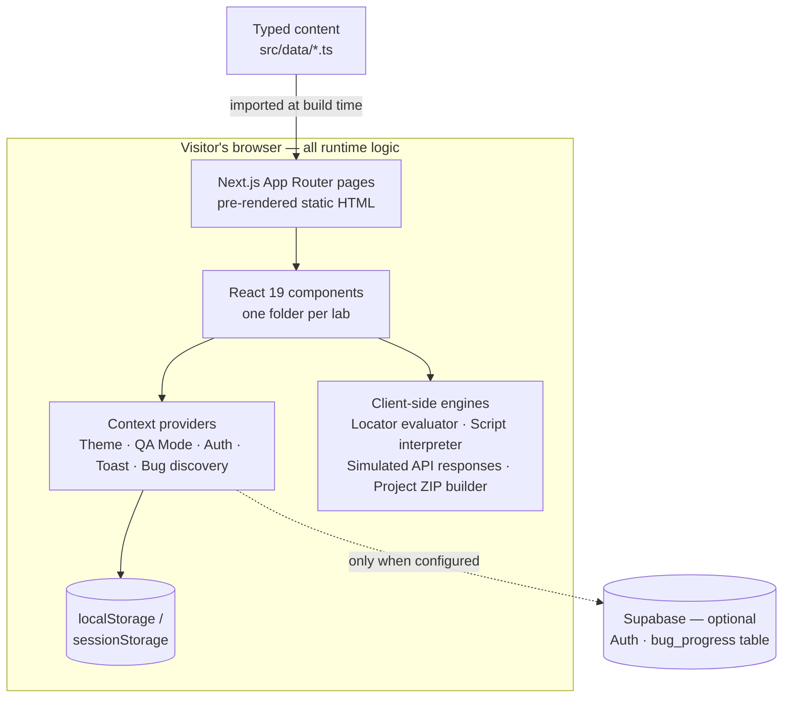
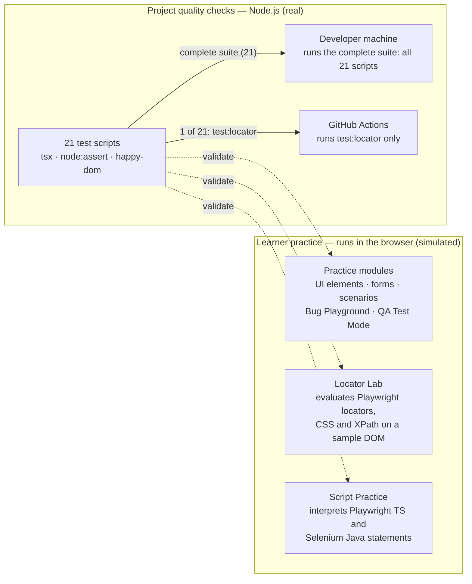
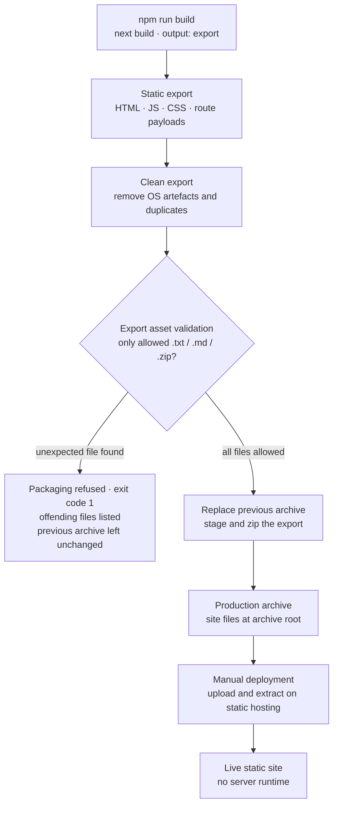

# Architecture

This document describes how QA Practice is built, how its practice features and its own quality checks work, and how the site is built and deployed. It is based on the current source code and describes only what is implemented.

QA Practice is a **fully static web application**. All runtime behaviour happens in the visitor's browser, and there is no application server in production. Supabase is the only external service it can use for application data, and it is optional.

← Back to the [project README](../README.md)

## Contents

1. [Application Architecture](#1-application-architecture)
2. [QA & Testing Architecture](#2-qa--testing-architecture)
3. [Build & Deployment](#3-build--deployment)
4. [Simulated vs. Real Behaviour](#4-simulated-vs-real-behaviour)
5. [Known Limitations](#5-known-limitations)

---

## 1. Application Architecture

### Layers

| Layer | Implementation | Responsibility |
|---|---|---|
| Framework | Next.js 15 (App Router), React 19, strict TypeScript | Routing, rendering, and static export of every page |
| Styling | Tailwind CSS v4, Framer Motion | Layout, theming, and animation |
| Content | Typed TypeScript modules in `src/data/` | Practice modules, scenarios, seeded bugs, locator challenges and lessons, API contracts, framework blueprints |
| Engines | Plain TypeScript in `src/lib/` | Locator parsing and evaluation, script interpretation, ZIP generation, formatting helpers |
| State | React context providers | Theme, QA Test Mode, authentication, notifications, and Bug Playground progress |
| Persistence | Browser storage, or Supabase when configured | Sessions, preferences, and bug-hunting progress |

### Key design decisions

- **Content is typed data.** Modules, challenges, bugs and API contracts are TypeScript objects, not hard-coded markup. Pages render this data, and the test scripts validate it.
- **No API routes.** A static export cannot serve server endpoints. The API Testing Lab therefore produces its responses in the browser from typed endpoint contracts, and the live dashboard reads sample JSON files that ship with the site.
- **State stays close to the user:**
  - **Theme:** stored in `localStorage`.
  - **QA Test Mode:** eight fault flags, such as slow API, server error and flaky modal, stored in `sessionStorage`, so they reset when the tab closes.
  - **Auth:** uses Supabase Auth when it is configured. Otherwise it falls back to a local demo session.
  - **Bug Playground progress:** stored in Supabase when it is configured, otherwise in `localStorage`.
- **Optional Supabase.** The application works without any configuration. Supabase is used only when its public URL and anon key are provided at build time.
- **Analytics.** Page views and a small set of practice events are sent to Google Analytics through the standard `gtag` script.

---

## 2. QA & Testing Architecture

The platform has two separate testing concerns:

- **Practice features for learners.** These run in the browser and *simulate* how test tools behave.
- **The project's own quality checks.** These are real automated tests that run in Node.js.

### Practice features

**Practice modules.** UI elements, forms, user-flow scenarios, edge cases, an iframes and Shadow DOM lab, and a Bug Playground with seeded defects.
- Interactive elements have stable `data-testid` attributes and accessible roles and labels, so learners can write their own tests against them.
- **QA Test Mode** injects controlled faults into the interface, such as delayed buttons, failed requests, empty tables and expired sessions.

**Locator Lab.** It parses Playwright-style locator chains (`page.getByRole(...)`, `page.locator(...)`, frame locators and others) and evaluates them against the challenge's sample markup in the page.
- It reports the match count, whether the intended target was matched, and a resilience rating.
- In the playground, CSS and XPath queries are evaluated with the browser's own `querySelectorAll` and `document.evaluate`, limited to the sample area.

**Script Practice.** Learners write short Playwright (TypeScript) or Selenium (Java) tests. A statement interpreter runs them step by step against a practice page loaded in an iframe.
- It models the most important difference between the tools: Playwright auto-waits and uses web-first assertions, while Selenium fails immediately unless an implicit or explicit wait is configured.
- Features it does not support are reported as unsupported rather than silently ignored.

**Code Lab.** It generates a complete Playwright project in the browser (JSZip and FileSaver), which learners download and run on their own machine with real Playwright.

### Project quality checks

There are 21 Node.js test scripts in `scripts/`, run with `tsx`. They use `node:assert`, and `happy-dom` where a DOM is needed. They are unit, content and build-output checks, **not** browser end-to-end tests.

| Area | Scripts |
|---|---|
| Locator Lab engine | `test:locator`, `test:locator-snippets`, `test:playground-scope`, `test:menu-position`, `test:dynamic-id` |
| Locator content | `test:locator-challenges`, `test:challenge-preview`, `test:challenge-ui`, `test:locator-content`, `test:locator-navigation`, `test:locator-strategies` |
| Lessons | `test:lesson-demos`, `test:english-lessons`, `test:lessons-first-five`, `test:lessons-advanced` |
| Iframes / Shadow DOM | `test:iframe-shadow-lab`, `test:embed-translate` |
| Script Practice | `test:script-practice` |
| Framework blueprint | `test:framework-blueprint` |
| Static output and packaging | `test:locator-redirect`, `test:verify-static-out` |

Notes:

- `test:dynamic-id` and `test:locator-redirect` also inspect the built HTML when a static export exists. Without one, they skip those checks.
- `happy-dom` cannot evaluate a few XPath and CSS cases. The scripts report these as skipped instead of passing them.

### Continuous integration

One GitHub Actions workflow runs `npm run test:locator` on Node.js 22, after `npm ci`. It is triggered by pushes and pull requests that change:
- the locator engine (`src/lib/locator-lab/**`),
- its test script,
- `package.json` or `package-lock.json`,
- or the workflow file itself.

The complete suite of 21 scripts is run locally. The other 20 scripts are not part of CI yet, and neither are the site build and deployment.

---

## 3. Build & Deployment

### Pipeline

1. **Static export.** `next build` with `output: "export"`, `trailingSlash: true` and unoptimised images writes every route as static files. Next.js also writes an `index.txt` route payload for each page, which the client uses during navigation.
2. **Packaging.** The `postbuild` script (`scripts/pack-static.mjs`) runs automatically after the build:
   - **Clean:** removes operating-system artefacts and duplicate files from the export.
   - **Validate:** checks the export assets (see below). If the check fails, packaging stops here.
   - **Package:** deletes the previous archive, copies the export to a staging folder, and creates one ZIP archive with the site files at its root.
3. **Deployment.** Deployment is **manual**. The archive is uploaded to static web hosting and extracted into the site's web root. No pipeline deploys the site automatically.

### Export asset validation

Everything in `public/` is copied into the static export unchanged. A file added there by mistake, such as an internal note or an old archive, would therefore go live. `scripts/verify-static-out.mjs` prevents this with an allowlist:

- It checks every `.txt`, `.md` and `.zip` file in the export, at any depth and regardless of letter case.
- It allows only:
  - `index.txt` in any folder (the Next.js route payloads),
  - `robots.txt` at the site root.
- Anything else, for example a nested `robots.txt`, `README.md` or any `.zip` file, stops packaging. The script:
  - prints a clear error that lists each file,
  - exits with code 1, so `npm run build` fails as well,
  - runs before the previous archive is touched, so a failed check never deletes or changes it.

All other output types, such as HTML, JavaScript, CSS, JSON and images, are not affected.

`test:verify-static-out` covers this check. It tests allowed and rejected files, including nested paths and case variations, and it runs the packaging script end to end to confirm that:
- a failed validation leaves the previous archive byte-for-byte unchanged,
- no staging folder is created.

---

## 4. Simulated vs. Real Behaviour

| Feature | What actually happens |
|---|---|
| Locator Lab | **Simulated.** Locator chains are parsed and evaluated against sample markup in the browser, not by Playwright. |
| Script Practice | **Simulated.** An interpreter runs a supported subset of the Playwright and Selenium APIs against a practice iframe. No browser driver or WebDriver is involved. |
| API Testing Lab, mailbox, live dashboard | **Simulated.** Responses and data are generated in the browser or read from static sample files. There are no backend endpoints. |
| QA Test Mode | **Simulated faults.** Delays, errors and flaky behaviour are injected on the client. |
| Code Lab project download | **Real project.** A runnable Playwright project is generated. Learners run it on their own machine, not in this repository. |
| Authentication and progress | **Real when Supabase is configured**, otherwise a local demo session and browser storage. |
| Test scripts in `scripts/` | **Real automated checks** in Node.js. |
| GitHub Actions | **Real CI**, limited to the locator parser test. |
| Export asset validation | **Real build gate.** It fails the build on unexpected files. |

---

## 5. Known Limitations

- **No end-to-end browser tests.** There is no browser end-to-end suite (Playwright or Selenium) running against the deployed application.
- **Limited CI scope.** CI runs one of the 21 test scripts. The build, the packaging validation and deployment are not automated in CI.
- **Validation guards the archive only.** The static export folder is written before validation runs. A manual upload of that folder, instead of the archive, would bypass the check.
- **The validation checks `.txt`, `.md` and `.zip` only.** It does not detect other unintended file types.
- **Middleware does not run in production.** Next.js middleware (Supabase session refresh and one redirect) runs only with `next dev` or `next start`, not in the static export.
